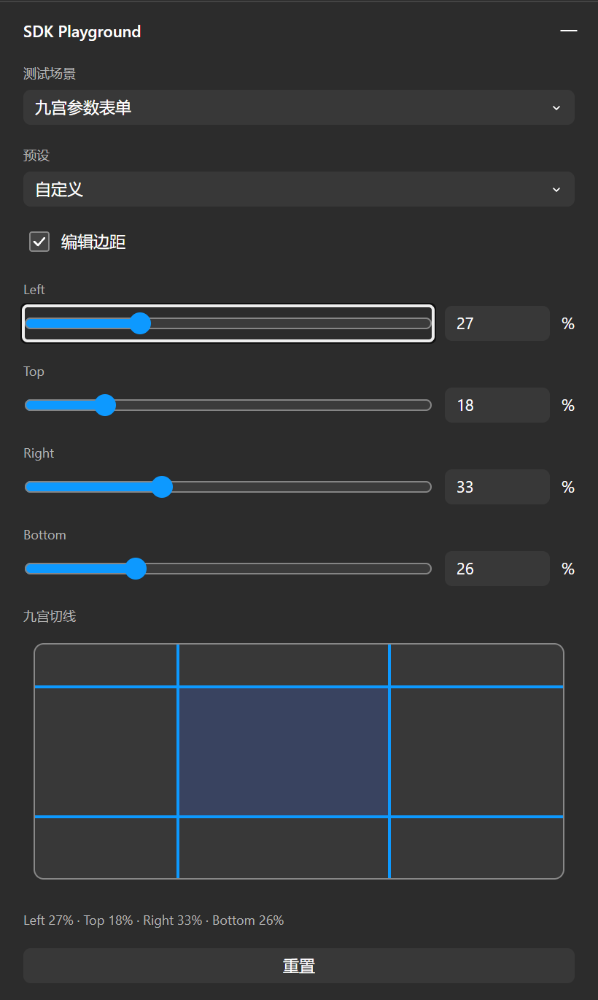
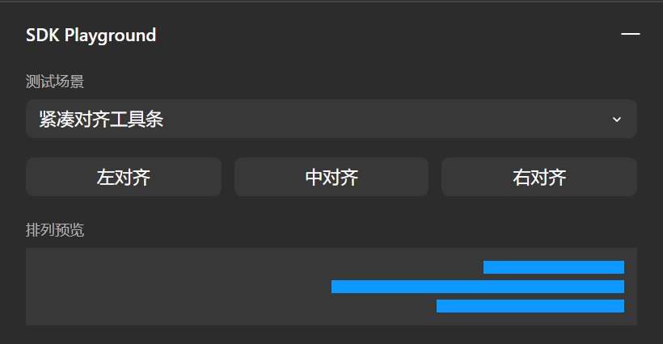
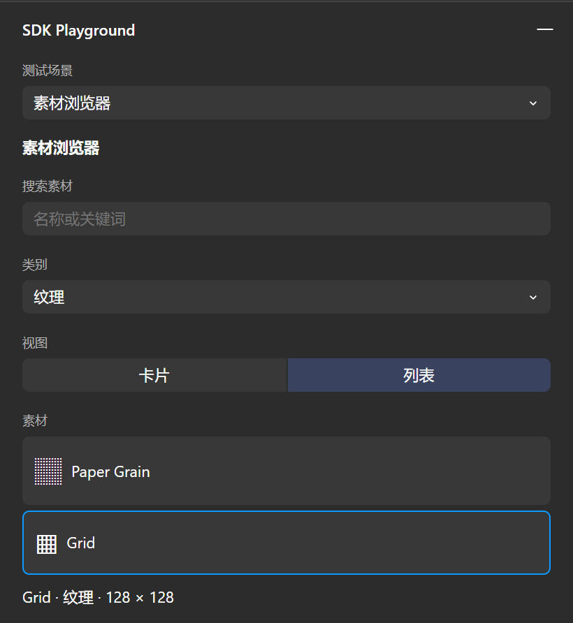
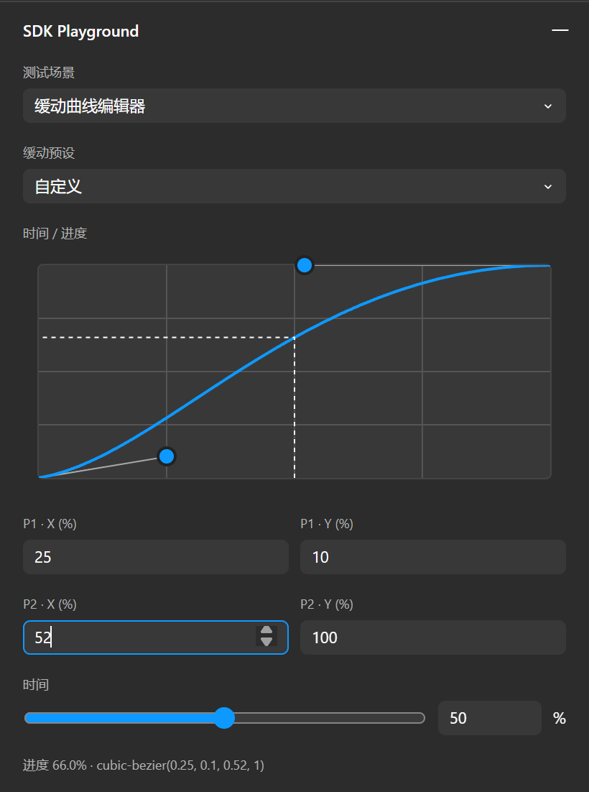
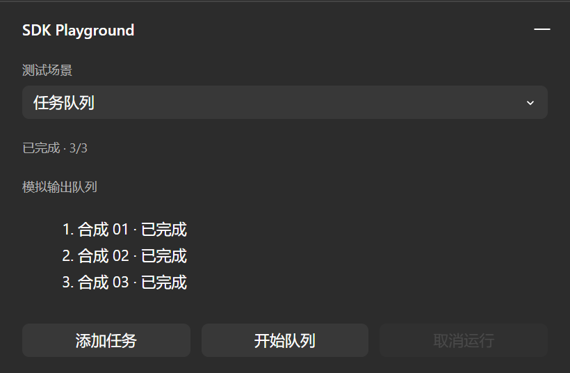
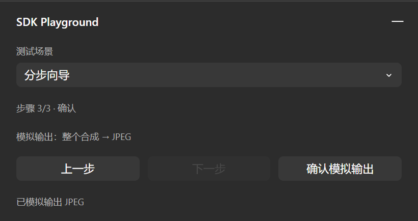
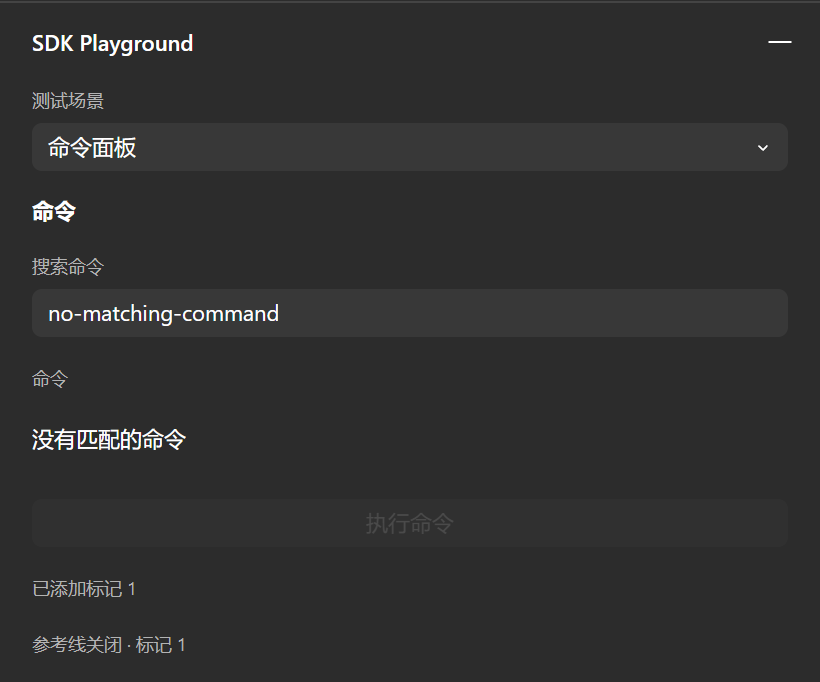
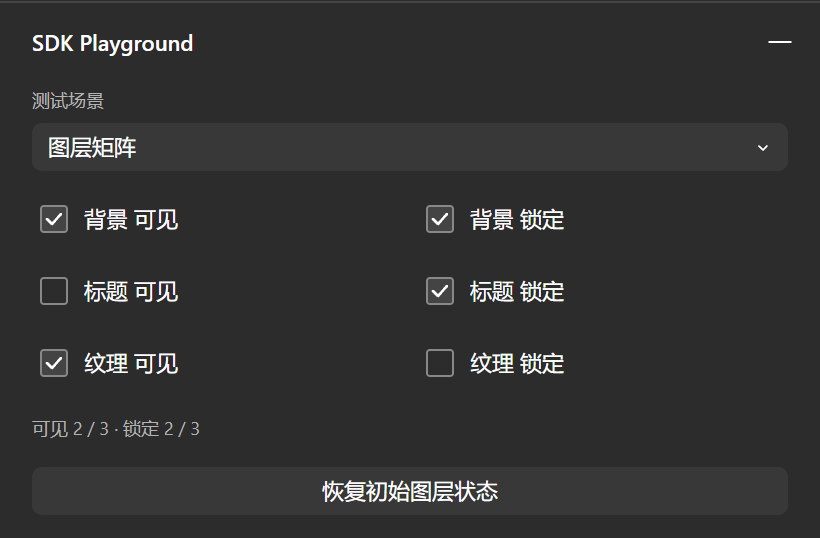

# SDK Playground

在 Figma Design 右侧展开 **SDK Playground**，用「测试场景」切换八个面板。可以在空白文档中操作。素材、图层和队列都来自示例数据，适合观察控件如何响应同一份状态。

将本目录复制到管理器「打开扩展目录」指向的位置，重新扫描、启用并应用扩展。示例版本为 **0.3.0**，最低要求 SDK 2.5，Canvas Extensions 0.7.0 随附 SDK 2.6。

## 九宫参数表单

选择「非对称」，四条切线会移到左 12%、上 18%、右 32%、下 26% 的位置。拖动切线可以直接改变对应边距，滑块和输入框也会同步。取消「编辑边距」可观察整组控件的禁用状态。用 Tab 聚焦切线后，方向键每次移动 1%，按住 Shift 移动 10%。[表单与切线实现](main.js)

## 紧凑对齐工具条

点左、中、右对齐，观察预览中的图形如何靠齐。三个动作共用一块预览区，适合只需点一次就能看到结果的操作。[工具条实现](forms.js)

## 素材浏览器

用类别缩小范围，再输入素材名。切换卡片与列表可以比较两种浏览方式；选中素材后查看详情。输入没有匹配项的词可以检查空结果状态。[素材浏览器实现](browser-panel.js)

## 缓动曲线编辑器

从一个缓动预设开始，拖动两个控制点，或直接输入坐标。曲线随编辑重绘，预设切换为自定义。改变取样时间可以读取曲线上对应的输出值。[曲线编辑实现](curve-panel.js)

## 任务队列

添加任务后点击「开始队列」，观察各行依次更新进度。中途取消，再次启动，能看到取消与完成两种状态。整个过程使用模拟任务。[队列实现](forms.js)

## 分步向导

先选图层范围，再选输出格式。返回上一步时范围会保留；最后一步列出两项选择，方便在确认模拟输出前核对。[向导实现](forms.js)

## 命令面板

搜索并选中「增加标记」，点击「执行命令」，可以看到执行回执。清空或改变搜索词会重新筛选命令；没有匹配项时，执行按钮禁用。[命令面板实现](commands-panel.js)

## 图层矩阵

每行对应一个示例图层。分别切换「可见」和「锁定」，观察两个计数独立变化；恢复初始状态可再次测试同一组操作。[图层矩阵实现](layers-panel.js)

以上截图由 Chromium 加载本目录的面板脚本和仓库 SDK 后生成。浏览器检查覆盖拖动、键盘、场景切换及卸载清理。[交互检查](../../checks/playground-browser-test.cjs)
